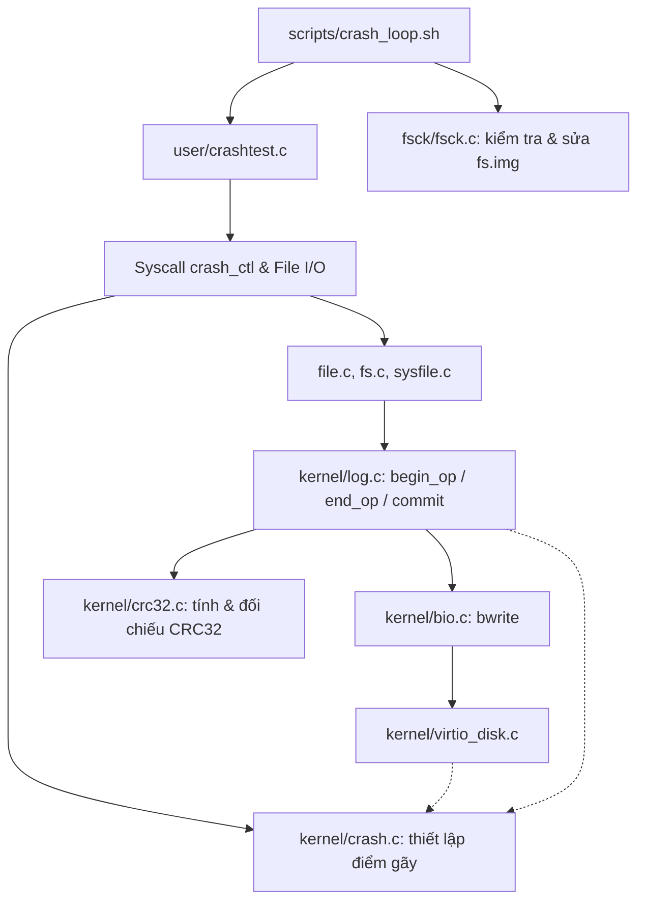

# Cấu trúc dự án C cho đề tài Crash consistency and fsck

Ngày: 24/10/2026. Thiết kế dành cho kernel xv6, với yêu cầu cấu trúc vừa đủ và dễ học.

## 1. Quyết định kiến trúc

Chọn **các module C theo trách nhiệm trong cấu trúc xv6 hiện có**, kết hợp tách riêng công cụ kiểm tra đĩa chạy trên máy host. Giữ API nhỏ, ẩn dữ liệu nội bộ và quy định rõ module nào gọi module nào.

Clean Architecture tập trung vào tách trách nhiệm và hướng phụ thuộc; sơ đồ gốc không bắt buộc đúng bốn tầng. [Bài viết của Robert C. Martin](https://blog.cleancoder.com/uncle-bob/2012/08/13/the-clean-architecture.html).

Với đồ án này, áp dụng nguyên tắc tách thuật toán tính checksum (`crc32.c`) khỏi cơ chế ghi nhật ký (`log.c`), và tách công cụ kiểm tra/sửa chữa (`fsck.c`) khỏi kernel đang chạy. Chưa cần tạo các project hoặc thư mục `Domain`, `Application`, `Infrastructure`, Virtual File System (VFS) hay một cơ chế driver động. Hệ thống logging của kernel trực tiếp làm việc với buffer cache, spinlock/sleeplock và trình điều khiển đĩa VirtIO; những phụ thuộc này là một phần của nhiệm vụ đang học.

Một lời gọi qua `.h` sang module `.c` đủ thể hiện ranh giới ban đầu. Chỉ thêm function-pointer interface khi có một nhu cầu cụ thể, chẳng hạn cùng một cơ chế kiểm tra phải chạy trên nhiều định dạng ổ đĩa khác nhau.

## 2. “Solution” tương ứng với gì trong dự án này?

| Trong dự án C# quen thuộc | Trong dự án xv6/C này |
|---|---|
| Solution `.sln` | Thư mục dự án và workspace VS Code |
| Project `.csproj` | Các target (`kernel/kernel`, `fs.img`, `fsck/fsck`) và danh sách object trong Makefile |
| Class cung cấp chức năng | Module `.c` với các hàm và struct liên quan (`log.c`, `crc32.c`, `crash.c`, `fsck.c`) |
| Public API | Hàm, hằng số, kiểu dữ liệu được khai báo trong `.h` (`crc32.h`, `crash.h`, `fs.h`) |
| Chi tiết private | Hàm/biến `static`, bảng tra cứu và struct nội bộ trong `.c` |
| Build solution | Cross-compile RISC-V cho kernel/user và native compile GCC cho `fsck` theo Makefile |

Không cần mỗi module trở thành một thư viện riêng. Các object file của kernel được link chung thành binary `kernel/kernel`, còn công cụ `fsck` và `corrupt` được biên dịch thành chương trình chạy trên Linux host để can thiệp trực tiếp vào `fs.img`. Bản thiết lập hiện tại chọn VS Code + Ubuntu + Make để theo sát tài liệu môn xv6. [Repo xv6 chính thức](https://github.com/mit-pdos/xv6-riscv), [MIT tools](https://pdos.csail.mit.edu/6.1810/2025/tools.html).

## 3. Những file đã dựng và cây mã dự kiến

Đã dựng thực tế:

```text
xv6-26121/
├── README.md
├── .gitignore
├── CMakeLists.txt
├── Makefile
├── kernel/                    # source xv6 gốc và các file khung crc32, crash
├── user/                      # source xv6 gốc và crashtest.c
├── mkfs/                      # source xv6 gốc đã nhập
├── fsck/                      # khung công cụ fsck.c và corrupt.c trên host
├── scripts/                   # kịch bản tự động hóa crash_loop.sh, test_corrupt.sh
├── results/                   # nơi lưu dữ liệu thực nghiệm
└── docs/
    ├── Kien-truc-du-an.md
    └── Nghien-cuu-de-tai.md
```

Cây dưới đây là **cấu trúc đích của đề tài**. Các module xv6 gốc đã được nhập và các file bổ sung cho nhiệm vụ:

```text
xv6-26121/
├── README.md
├── .gitignore
├── CMakeLists.txt
├── Makefile                   # giữ build system của xv6 + thêm rule build fsck
├── kernel/
│   ├── log.c                  # mã gốc mở rộng: gắn CRC32 khi commit, verify khi recovery
│   ├── crc32.c                # bổ sung: thuật toán tính checksum CRC32
│   ├── crc32.h                # bổ sung: API tính CRC32 dùng cho log
│   ├── crash.c                # bổ sung: quản lý trạng thái và kích hoạt crash-injection
│   ├── crash.h                # bổ sung: mã các điểm gãy (commit, install, disk write)
│   ├── virtio_disk.c          # tích hợp điểm tiêm lỗi khi ghi sector xuống đĩa
│   ├── fs.h                   # mở rộng struct logheader thêm trường crc32
│   ├── fs.c                   # quản lý inode, bitmap và thư mục của kernel
│   ├── bio.c                  # quản lý buffer cache dưới tầng log
│   ├── sysfile.c              # bổ sung syscall điều khiển điểm crash và fsync
│   ├── spinlock.c             # giữ cơ chế khóa của xv6
│   └── ...                    # các file gốc khác
├── user/
│   ├── crashtest.c            # bổ sung: sinh tải hệ thống file và kích hoạt crash
│   └── ...                    # các chương trình gốc (usertests, stressfs, logstress...)
├── mkfs/                      # mã gốc: tạo filesystem image ban đầu
├── fsck/
│   ├── fsck.c                 # bổ sung: kiểm tra và sửa bitmap, link counts, thư mục
│   └── corrupt.c              # bổ sung: chủ động làm hỏng fs.img để kiểm thử fsck
├── docs/                      # thiết kế và báo cáo tiến độ
├── scripts/
│   ├── crash_loop.sh          # bổ sung: lặp 200+ lần crash QEMU -> reboot -> fsck
│   └── test_corrupt.sh        # bổ sung: tự động hóa kiểm thử sửa ảnh đĩa hỏng
└── results/                   # lưu log kết quả 200+ lần chạy
```

Giữ các file kernel mới (`crc32.c`, `crash.c`) cạnh các module hệ thống file liên quan trong `kernel/`; chưa chuyển toàn bộ mã gốc vào một cây `src/` mới. Công cụ `fsck/` đặt ngang hàng với `mkfs/` vì cả hai đều là chương trình chạy trên máy host thao tác trực tiếp lên file ảnh đĩa `fs.img`.

## 4. Trách nhiệm của từng module

| Module | Trách nhiệm | Dữ liệu nội bộ |
|---|---|---|
| `kernel/log.c` | Gom giao dịch, tính CRC32 trước khi ghi header, kiểm tra CRC32 khi boot recovery | `struct log`, `struct logheader`, danh sách block trong giao dịch |
| `kernel/crc32.c` | Tính mã kiểm tra CRC32 cho header và các data block của log | Bảng tra cứu `crc32_table` (static) và hàm tính toán |
| `kernel/crc32.h` | Công bố API tính checksum cho `log.c` | Chỉ prototype hàm `crc32()` |
| `kernel/crash.c/.h` | Lưu cấu hình điểm gãy, đếm số lượt ghi đĩa và đánh sập QEMU khi chạm ngưỡng | `crash_point`, `crash_counter` và `spinlock` bảo vệ |
| `kernel/virtio_disk.c` | Thực hiện I/O đĩa vật lý và gọi hook kiểm tra điểm crash tại tầng driver | Trạng thái hàng đợi VirtIO và descriptor ring |
| `user/crashtest.c` | Nhận tham số kịch bản, gọi syscall đặt bẫy crash, tạo tải ghi file/thư mục | Tham số dòng lệnh và dữ liệu mẫu ghi file |
| `fsck/fsck.c` | Đọc `fs.img`, đối chiếu và sửa chữa bitmap, `nlink` của inode, cấu trúc thư mục (`.` và `..`) | Bản đồ bit thực tế, bảng đếm tham chiếu inode trong bộ nhớ host |
| `fsck/corrupt.c` | Phá hỏng có chủ đích một phần siêu dữ liệu trên `fs.img` để kiểm tra `fsck` | Con trỏ vùng nhớ mmap của `fs.img` và các chế độ tiêm lỗi |
| `scripts/` | Lặp 200+ chu kỳ chạy QEMU, bắt sự kiện crash, khởi động lại và chạy `fsck` | Biến đếm vòng lặp và file log kết quả trên máy host |

Biến đếm trạng thái crash nằm ngay trong `crash.c`. Chưa tách riêng các file nhỏ như `bitmap_check.c`, `dir_check.c`, `link_check.c` khi toàn bộ quy trình quét ảnh đĩa trong `fsck/fsck.c` vẫn dùng chung con trỏ vùng nhớ `mmap` của `fs.img` và có thể viết rõ ràng trong các hàm `static` tách biệt.

Khi làm tới mục tiêu mở rộng (stretch goals) như `group commit` hoặc `fsync`, logic điều phối giao dịch vẫn nằm trong `log.c` và `sysfile.c` để giữ tính cục bộ của khóa `log.lock`.

## 5. Hướng gọi giữa các module



Đây là hướng gọi chức năng của đề tài, thể hiện cả luồng trong kernel lẫn luồng kiểm tra ngoài máy host.

Các thao tác hệ thống file (`fs.c`, `sysfile.c`) chỉ gọi `begin_op()`, `log_write()` và `end_op()` của `log.c` mà không cần biết `log.c` tính CRC32 như thế nào. `log.c` gọi `crc32.c` để lấy mã băm 32-bit và ghi vào `logheader`.

Module `crash.c` đóng vai trò điểm chặn thụ động: `log.c` và `virtio_disk.c` gọi `crash_check(point)` tại những vị trí nhạy cảm (ngay trước khi ghi header, sau khi ghi header, hoặc giữa lúc chép dữ liệu). Nếu điểm kiểm tra khớp với cấu hình từ syscall, `crash.c` lập tức dừng máy ảo QEMU để mô phỏng mất điện.

Công cụ `fsck/fsck.c` chạy độc lập trên máy host sau khi QEMU tắt, đọc trực tiếp file `fs.img` theo định dạng được quy định trong `kernel/fs.h`, tuyệt đối không gọi vào các hàm của kernel.

## 6. Quy tắc viết module C

Một module thường gồm `.h` công bố cách dùng và `.c` chứa cách làm. Những module xv6 gốc đã có prototype trong `defs.h` có thể giữ theo quy ước gốc; các module mới bổ sung có header riêng để phân tách rõ ràng.

Ví dụ khai báo API ban đầu cho module CRC32 và Crash Injection, theo quy ước kiểu dữ liệu của xv6:

```c
// kernel/crc32.h - Caller đã include types.h theo quy ước của xv6.
#ifndef XV6_CRC32_H
#define XV6_CRC32_H

uint32 crc32(uint32 crc, const void *buf, uint64 size);

#endif
```

```c
// kernel/crash.h
#ifndef XV6_CRASH_H
#define XV6_CRASH_H

#define CRASH_NONE              0
#define CRASH_COMMIT_BEFORE_HDR 1
#define CRASH_COMMIT_AFTER_HDR  2
#define CRASH_INSTALL_MID       3
#define CRASH_DISK_WRITE        4

void crash_init(void);
void crash_set(int point, int count);
void crash_check(int point);

#endif
```

Đoạn này minh họa thiết kế header tạo ranh giới giữa các module.

Trong `log.c` và `fsck.c`, các hàm chỉ dùng nội bộ như ` compute_log_crc`, `check_bitmap`, `check_inodes`, `check_dirs` và `repair_nlink` nên được khai báo là `static`.

Quy tắc thực hành:

- Include header thay vì include file `.c`; Makefile biên dịch các `.c` và linker ghép các `.o`.

- Không đặt định nghĩa biến global dùng chung trong header. Chọn một nơi sở hữu dữ liệu (`log` trong `log.c`, trạng thái điểm gãy trong `crash.c`); dùng API để truy cập.

- Đặt tên diễn tả đúng khái niệm hệ thống file: superblock, inode, dinode, bitmap, logheader, sector và transaction.

- Dùng spinlock/sleeplock đúng cơ chế của xv6; chú ý thứ tự khóa giữa `log.lock` và buffer sleeplock.

- Mã nguồn trong `kernel/` chỉ dùng tiện ích sẵn có của xv6; tuyệt đối không include `<stdio.h>`, `<stdlib.h>` của libc vào kernel. Ngược lại, `fsck/fsck.c` chạy trên host nên được phép dùng thư viện chuẩn C (`stdio.h`, `fcntl.h`, `sys/mman.h`).

- Đảm bảo kích thước `struct logheader` sau khi thêm trường `uint32 crc` vẫn nhỏ hơn hoặc bằng kích thước một khối đĩa (`BSIZE = 1024` bytes).

- Khi kích hoạt crash trong kernel để mô phỏng mất điện, dừng máy ảo tức thì (ví dụ ghi vào thanh ghi syscon poweroff của QEMU tại `0x100000` hoặc `panic`) mà không thực hiện thêm bất kỳ lệnh flush đĩa nào.

## 7. Hai ngữ cảnh thực thi (Kernel vs Host) và tính tương thích cấu trúc đĩa

`kernel/fs.h` được include bởi cả mã nguồn kernel (kiến trúc RISC-V 64-bit) lẫn công cụ `fsck/fsck.c` và `mkfs/mkfs.c` (chạy trên máy host x86_64). Không được sử dụng các kiểu dữ liệu có kích thước phụ thuộc nền tảng (như `long` hay con trỏ) bên trong các struct biểu diễn dữ liệu trên đĩa (`superblock`, `dinode`, `dirent`, `logheader`).

Để đảm bảo tính nhất quán giữa kernel và công cụ `fsck`, đề xuất:

| Thành phần | Trong Kernel (`kernel/log.c`, `fs.c`) | Trong Host Tool (`fsck/fsck.c`) |
|---|---|---|
| Định dạng đĩa | Dùng `struct superblock`, `dinode`, `logheader` từ `fs.h` | Include cùng file `kernel/fs.h` để đọc chính xác từng byte |
| Cơ chế truy cập | Qua buffer cache (`bread`, `bwrite`, `brelse`) | Đọc/ghi trực tiếp file `fs.img` qua `mmap` hoặc `pread`/`pwrite` |
| Xử lý lỗi lúc boot | `recover_from_log()` kiểm tra CRC32, chỉ replay nếu checksum đúng | `fsck` quét toàn bộ cây thư mục, bitmap và sửa lại các sai lệch |

Thứ tự khôi phục tổng quát sau một sự cố sập nguồn:
1. Kiểm tra bằng `fsck` trên máy host (hoặc kiểm tra ảnh đĩa).
2. Khi khởi động lại xv6, `fsinit()` gọi `initlog()` $\rightarrow$ `recover_from_log()` đọc `logheader`:
   - Nếu `n > 0` và `crc32` khớp: thực hiện `install_trans()` để hoàn tất giao dịch dở dang.
   - Nếu `n > 0` nhưng `crc32` sai lệch (do crash giữa lúc đang ghi log): bỏ qua không chép dữ liệu lỗi và xóa `logheader` (`n = 0`).

## 8. Build system vừa đủ

Giữ `Makefile` gốc của xv6. Kernel và chương trình user được cross-compile cho RISC-V; còn `mkfs`, `fsck` và `corrupt` được biên dịch bằng `gcc` của máy host. [xv6 Makefile được khảo sát](https://raw.githubusercontent.com/mit-pdos/xv6-riscv/4ded343d5d9d40d4e9dcf4867ca45b14170bf364/Makefile).

Khi thêm `crc32.c` và `crash.c`, bổ sung `$K/crc32.o` và `$K/crash.o` vào danh sách `OBJS` của kernel. Khi tạo `crashtest.c`, bổ sung `$U/_crashtest` vào danh sách `UPROGS` và đăng ký syscall tương ứng. Với bộ công cụ trên máy host, thêm rule biên dịch cạnh `mkfs/mkfs`:

```makefile
fsck/fsck: fsck/fsck.c $K/fs.h $K/param.h $K/crc32.h
	gcc -Werror -Wall -I. -o fsck/fsck fsck/fsck.c

fsck/corrupt: fsck/corrupt.c $K/fs.h $K/param.h
	gcc -Werror -Wall -I. -o fsck/corrupt fsck/corrupt.c
```

File `CMakeLists.txt` đi kèm chỉ đóng vai trò hỗ trợ IDE (CLion / VS Code IntelliSense) nhận diện đường dẫn header, toàn bộ quá trình biên dịch thực tế vẫn thực hiện thống nhất qua lệnh `make`.

## 9. Thiết lập môi trường theo thứ tự

Môi trường phát triển sử dụng trực tiếp Ubuntu (hoặc Ubuntu 24.04 trên WSL 2) kết hợp VS Code và Git.

1. Trong terminal Ubuntu, cài bộ công cụ MIT đề xuất:

   ```bash
   sudo apt-get update
   sudo apt-get install -y git build-essential gdb-multiarch qemu-system-misc \
                           gcc-riscv64-linux-gnu binutils-riscv64-linux-gnu bc perl
   ```

2. Clone hoặc mở thư mục dự án `xv6-26121` trong VS Code bằng lệnh `code .`.

3. Build và kiểm tra **xv6 cùng bộ khung fsck** trước khi can thiệp sâu vào thuật toán:

   ```bash
   make kernel/kernel fs.img fsck/fsck fsck/corrupt
   ./fsck/fsck fs.img
   make qemu CPUS=3
   ```

   Khi có shell xv6, chạy thử `usertests -q` hoặc `logstress` để xác nhận hệ thống gốc hoạt động ổn định. Thoát QEMU bằng `Ctrl+A`, rồi `X`.

4. Ghi nhận baseline commit trên nhánh `main` của repository [HuyDam05/xv6-26121](https://github.com/HuyDam05/xv6-26121), sau đó phát triển từng mốc tính năng.

Tài liệu nền tảng: [MIT tools và WSL 2](https://pdos.csail.mit.edu/6.1810/2025/tools.html), [Sách xv6 - Chương 8: File system](https://pdos.csail.mit.edu/6.1810/2025/xv6/book-riscv-rev4.pdf).

## 10. Thứ tự viết code để tránh mở rộng sớm

| Mốc | Phần làm | Tiêu chí hoàn thành |
|---|---|---|
| 0 | Starter, toolchain và khung dự án | Kernel xv6, `crashtest` và host `fsck` biên dịch/chạy được |
| 1 | `crc32.c/.h` và tích hợp vào `log.c` | Tính CRC32 khi commit; phát hiện và bỏ qua log hỏng khi recovery |
| 2 | `crash.c/.h`, syscall và điểm tiêm lỗi | Chủ động đánh sập QEMU đúng thời điểm giữa lúc commit hoặc ghi đĩa |
| 3 | `fsck.c` (chế độ kiểm tra - Check) | Phát hiện đúng lỗi bitmap, lệch `nlink`, inode mồ côi và hỏng thư mục `.`/`..` |
| 4 | `fsck.c` (chế độ sửa lỗi - Repair) & `corrupt.c` | Sửa thành công ảnh đĩa bị làm hỏng, mount lại vào xv6 chạy bình thường |
| 5 | `scripts/crash_loop.sh` & `crashtest.c` | Chạy tự động 200+ lần crash giữa lúc commit $\rightarrow$ reboot $\rightarrow$ `fsck` báo clean |
| 6 | Stretch goals: Group commit và `fsync` | Gom nhiều giao dịch cùng commit và hỗ trợ ép ghi đĩa theo file descriptor |

Không viết gộp toàn bộ tính năng sửa đĩa phức tạp ngay từ đầu. Làm hoàn chỉnh phần kiểm tra (Check) trước, đối chứng bằng công cụ tiêm lỗi `corrupt.c`, rồi mới viết phần tự động sửa (Repair).

## 11. Tiêu chí cấu trúc hợp lý

Một người mới vào dự án cần xác định được ngay: thuật toán CRC32 nằm ở đâu; quá trình ghi và khôi phục nhật ký diễn ra ở đâu; điểm bẫy mất điện được kích hoạt thế nào; công cụ `fsck` kiểm tra những bất biến nào của đĩa; kịch bản 200+ lần crash gọi vào đâu; và `Makefile` biên dịch những gì.

Với bản thiết kế này, `kernel/log.c` + `kernel/crc32.c` + `kernel/crash.c` là ranh giới xử lý trong kernel, còn `fsck/fsck.c` + `scripts/crash_loop.sh` là ranh giới kiểm chứng và khôi phục ngoài máy host. Cách tổ chức này đủ gọn để học lập trình hệ thống C/kernel và đáp ứng đầy đủ yêu cầu thực nghiệm của đề tài.